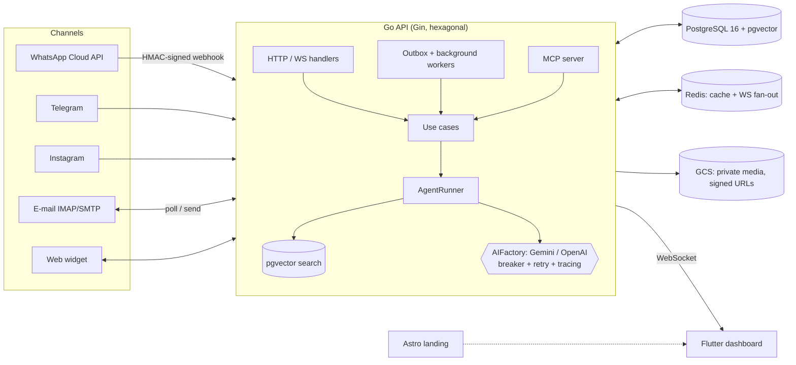

# Replider

> AI customer-service and B2B sales agent platform: an omnichannel inbox, RAG-grounded AI agents, a real-time human takeover dashboard and an autonomous SDR. Built end to end by a single developer.

**Status:** discontinued in 2026. <!-- TODO(Tiago): one line on why, in your own words -->
This repository is a cleaned public snapshot of a private codebase that ran in production from March to September 2026. Internal product/strategy documents, customer-identifying data and deployment secrets were removed; the code is otherwise as it shipped.

## What it does

- **Omnichannel inbox.** Businesses connect WhatsApp (Meta Cloud API), Telegram, Instagram DMs, e-mail (Gmail OAuth / IMAP / SMTP), SMS (Twilio) and an embeddable web widget.
- **AI agents grounded in a knowledge base.** Inbound messages are answered by an agent that retrieves context with pgvector (RAG), can call tools (e.g. calendar booking) and hands off to a human.
- **Real-time dashboard.** Human attendants follow conversations live and take over at any moment (Flutter, WebSocket).
- **Autonomous SDR (later pivot).** For healthcare B2B: hunts leads from Brazilian public registries (CNES, PNCP), drafts outreach and queues it for human approval. Nothing is sent without a person approving it.
- **MCP server.** The platform can be operated from AI assistants through the Model Context Protocol, under the same authorization rules as the HTTP API.

## Architecture



**Inbound message flow:**
1. A channel webhook arrives. WhatsApp payloads are verified with HMAC-SHA256 and written to a Postgres **outbox**, so the provider gets a fast 200 and processing is decoupled from receipt.
2. `SaveInbound` resolves channel → account → conversation and stores the message. A debounce groups message bursts.
3. `ProcessAI` skips human-only channels, paused bots (human takeover) and accounts over their limits.
4. `AgentRunner` builds the prompt: persona → agent instructions → top-5 RAG chunks (cosine distance in pgvector) → tool definitions → history. It then streams the model response through the provider chain (circuit breaker, retry, tracing, per-account spend cap).
5. The reply is sent through the channel adapter and broadcast over WebSocket. Redis pub/sub fans the event out across API instances.

## Repository layout

| Path | What |
|---|---|
| [`api/`](api) | Go API: hexagonal architecture (`core/domain` → `core/usecases` → `adapters`), sqlc, 230+ migrations, unit + E2E tests |
| [`app/`](app) | Flutter dashboard (web/mobile): Riverpod, GoRouter, Dio/Retrofit, Drift, Slang i18n |
| [`web/`](web) | Astro 6 + React 19 + Tailwind 4 landing page |
| [`widget/`](widget) | Embeddable chat widget (Preact) |
| [`e2e/`](e2e) | Playwright browser tests |
| [`infra/`](infra) | Prometheus, Alertmanager, Grafana, k6 load tests, OpenTofu (DNS) |
| [`docker/`](docker), [`nginx/`](nginx), [`docker-compose.prod.yml`](docker-compose.prod.yml) | Production stack: nginx + Let's Encrypt, Postgres with WAL-G backups |
| [`deploy/github-actions/`](deploy/github-actions) | The original CD pipelines (lint → test → GHCR image → SSH deploy), kept for reference and **not** active here |
| [`docs/`](docs) | A few technical design notes (WebSocket scaling, BFF decision, observability, migrations) |

## Stack

| Layer | Tech |
|---|---|
| API | Go 1.25, Gin, sqlc + pgx, golang-migrate, OpenTelemetry, Prometheus, Sentry |
| Data | PostgreSQL 16 + pgvector, Redis (optional) |
| AI | Gemini and OpenAI: streaming, tool calling, embeddings, batch API; BYOK keys encrypted with AES-GCM |
| Dashboard | Flutter, Riverpod, GoRouter, Dio/Retrofit, Drift |
| Landing / widget | Astro, React, Tailwind / Preact |
| Ops | Docker Compose, nginx, GitHub Actions, WAL-G, OpenTofu |

## Running locally

Prerequisites: Docker, Go 1.25+ (to run tests), Flutter (for the dashboard), Node 22+ (for the landing page), and a **Gemini or OpenAI API key**. There is no offline/fake LLM provider.

```bash
# API + Postgres/pgvector with hot reload (migrations run on start)
cd api
cp .env.example .env        # set JWT_SECRET, DB_* and GEMINI_API_KEY or OPENAI_API_KEY
make docker-dev
curl http://localhost:8080/health
open http://localhost:8080/swagger/index.html

# Dashboard
cd ../app
flutter pub get
flutter run -d chrome --dart-define=API_BASE_URL=http://localhost:8080/v1

# Landing page
cd ../web && npm install && npm run dev
```

Real channels (WhatsApp, Telegram, Gmail) need their own developer apps and credentials; see [`api/.env.example`](api/.env.example).

### Tests

```bash
cd api && make test        # unit tests
cd api && make test-e2e    # E2E against a real Postgres (Docker)
cd app && flutter test
```

## Technical decisions

- **Hexagonal architecture.** Domain and use cases import no infrastructure, so every adapter (LLM, channel, payment, storage) can be swapped and is faked in tests.
- **sqlc instead of an ORM.** SQL is the source of truth and Go types are generated from it, so every query is reviewable.
- **Postgres as the queue.** A transactional outbox plus background workers instead of a message broker: one less moving part at this scale, consistent with the data it describes.
- **pgvector instead of a separate vector database.** Retrieval sits next to the tenant data and is isolated by the same queries.
- **Redis pub/sub for WebSocket fan-out.** Dashboards stay live across multiple API instances, and the API degrades gracefully if Redis is down.
- **BYOK and per-account spend caps.** AI cost is bounded per tenant, and customer keys are encrypted at rest.
- **Security by default.** HMAC-verified webhooks, channel credentials encrypted at rest, TOTP 2FA, RBAC, SSRF-safe HTTP client, antivirus scanning of attachments, secret redaction in logs.

## What I'd do differently today

- Ship a much smaller MVP and validate demand before building breadth. The codebase grew faster than the customer base.
- Split the composition root: `cmd/api/main.go` wires everything by hand in one very long file.
- Build fake LLM and channel providers plus a one-command dev environment on day one.
- Measure test coverage in CI from the start.
- Deploy to a managed platform with zero-downtime rollouts instead of SSH + Docker Compose on a single VPS.
- Keep product and strategy documents out of the code repository.

## License

[MIT](LICENSE). The "Replider" name and logo are not covered by the license.
